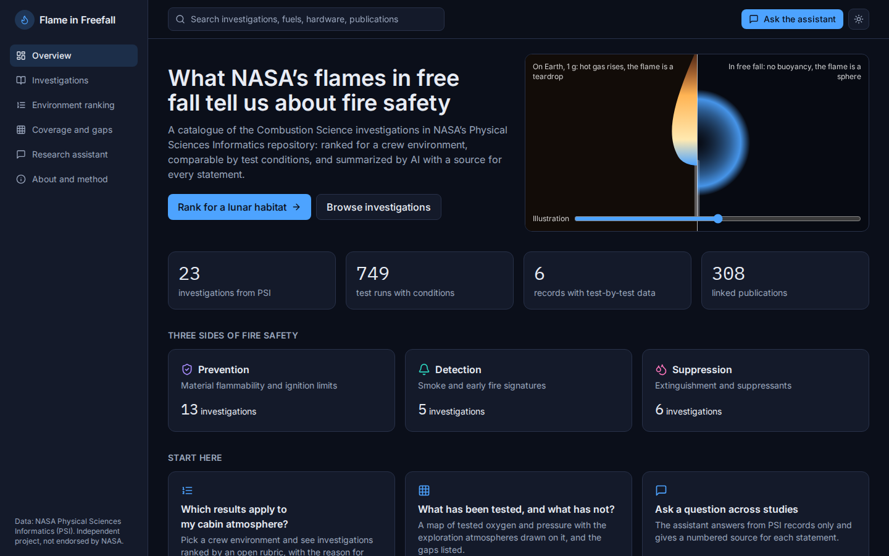
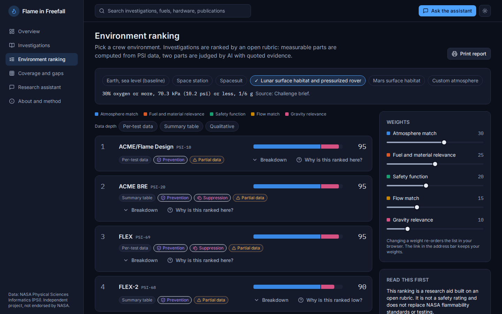
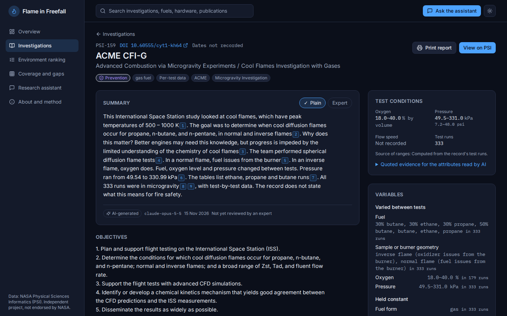
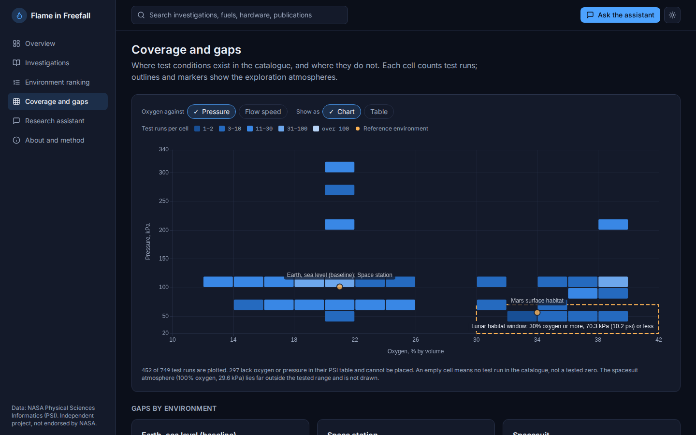

# Flame in Freefall

**Ranked, comparable and cited fire-safety insight from NASA's microgravity combustion experiments.**

**Live demo: http://147.45.185.185:2026/** (desktop browser recommended)



Flame in Freefall is a web dashboard built on NASA's [Physical Sciences Informatics (PSI)](https://psi.nasa.gov/physci/repo/search?q=combustion&data_source=psi&data_type=investigation) repository. It summarizes, ranks and interprets the Combustion Science investigations flown on the International Space Station and other missions, and turns them into fire-safety insight for crewed spacecraft, stations, lunar and Martian habitats.

One rule shapes the design: **structured first, AI second.** Every number on a chart comes from the database, which is loaded from PSI records. Every AI statement links to the PSI record it is based on, and a program checks it before it is shown.

## For judges: a two-minute tour

1. **Open the [lunar habitat ranking](http://147.45.185.185:2026/ranking?env=lunar-habitat).** Investigations are ranked for a habitat with 30% oxygen or more at 70.3 kPa (10.2 psi) or less. Each row shows a stacked bar of its five sub-scores. Press **Breakdown** to see the weight, score, one-sentence reason and PSI source for each criterion. Move a weight slider: the order changes instantly in the browser.
2. **Open the top record**, for example [ACME CFI-G](http://147.45.185.185:2026/investigations/PSI-159). Read the AI summary at two levels (**Plain** and **Expert**), click a numbered chip to see the exact source passage, and open **Quoted evidence** to see the word-for-word quote behind each attribute the AI read.
3. **Open [Coverage and gaps](http://147.45.185.185:2026/coverage).** A heatmap shows which oxygen and pressure combinations have been tested, with the lunar window and the Earth, station and Mars atmospheres drawn on it. Gap cards list what is untested, such as the 100% oxygen spacesuit atmosphere, and the nearest investigations.
4. **Ask the [research assistant](http://147.45.185.185:2026/assistant)** a question such as *"How do BASS-II and Saffire differ in sample size and flow?"*. The answer streams in with numbered sources and a mark that says whether its numbers were found in the cited records.

A longer walkthrough is in [docs/demo-script.md](docs/demo-script.md).

## How it answers the challenge

| The challenge asks to… | Flame in Freefall… |
| --- | --- |
| Summarize combustion investigations | Gives every investigation an AI summary at two reading levels, with a citation on each statement, beside the original PSI text |
| Rank them for human space exploration | Ranks all records for five crew environments (Earth, space station, spacesuit, lunar habitat, Mars habitat) or any custom atmosphere, with an open, adjustable rubric |
| Interpret them for fire safety | Tags each record as prevention, detection or suppression, maps tested conditions against exploration atmospheres, and names the gaps |
| Support researchers and modelers | Parses 749 test runs from seven PSI experiment tables into normalized oxygen, pressure and flow values, with the original row, file and row number kept for each; CSV and JSON export with provenance |
| Address partial gravity | States plainly that PSI holds no partial-gravity data and names the records that can bound lunar and Martian behaviour (microgravity with 1 g reference tests, electric-field proxies) |

## Screenshots

| Ranking with score breakdown | Cited AI summary |
| --- | --- |
|  |  |



## What is inside

**Data.** 23 Combustion Science investigations from PSI, including the twelve named in the challenge brief: BASS, BASS-II, Saffire-I, -II and -III, ACME BRE, SAME, SAME-R, FLEX, FLEX-2, ACME CFI-G and ACME E-FIELD Flames. The catalogue also holds 308 linked publications and 749 test runs parsed from the experiment tables of FLEX, ACME CFI-G, BASS-II and the three Saffire flights. Units are fixed (oxygen in percent by volume, pressure in kPa with psi beside it, flow in cm/s), and a missing value stays missing: it is never replaced with zero or an estimate.

**Ranking rubric.** A weighted rubric, explained on the [About page](http://147.45.185.185:2026/about):

| Criterion | Weight | Scored by |
| --- | --- | --- |
| Atmosphere match: tested oxygen and pressure against the environment | 30 | Code, from test runs or stated ranges |
| Fuel and material relevance to crew-cabin materials | 25 | AI, once per record, with quoted evidence |
| Safety function: prevention, detection or suppression | 20 | AI, once per record, with quoted evidence |
| Flow match: tested flow against ventilation speed | 15 | Code |
| Gravity relevance: microgravity, 1 g reference, partial-gravity proxy | 10 | Code |

A criterion with no data is marked "not available", and the total is rescaled over the others and tagged "partial data". Data depth is shown as a badge, not scored.

**AI, built on the Claude API.** Claude reads, structures and interprets the records; it never supplies a number on a chart.

| Job | Model | Safeguard |
| --- | --- | --- |
| Attribute extraction (fuel state, safety function, condition ranges, sensors) | Claude Opus 5.5, structured output | Every value carries an exact quote; a program rejects the result if a quote is not found word for word in the source, or a number is missing from its quote. Unit conversion is done in code |
| Investigation summaries, plain and expert | Claude Opus 5.5, citations on PSI documents | Every summary must carry citations; every number must appear in the cited record, or the summary is not published |
| Research assistant | Claude Sonnet 5.5, streaming, three read-only tools | Answers cite tool results; numbers are checked when the stream ends; off-topic questions are declined; a daily token limit and per-session caps protect the budget |

All AI text is labelled with its model and date and marked "not yet reviewed" until an expert approves it. A response the model declines to give is never stored or shown. The site states on every page that it is a research aid, not a replacement for NASA flammability standards or testing.

## Known limitations

- **Two rubric criteria are not generated yet.** Fuel relevance and safety function need a Claude run that the build budget did not cover, so every ranking currently rests on atmosphere, flow and gravity, and every row carries the "partial data" tag.
- **Seed data, not live ingestion.** Records come from an export of PSI taken on 14 November 2026. There is no scheduled refresh in this build.
- **Test-by-test data for six records.** Other experiment tables are stored and used by the AI but are not charted.
- **Flow match is not scored for the reference environments,** because the challenge brief gives no ventilation speed for them. It is scored for a custom atmosphere with a flow range.
- **Not built in the hackathon scope:** a Compare page, a full Data explorer, Earth applications and a Learn page.
- **The flame image on the Overview is a drawing,** not NASA imagery.

The full list is in [docs/limitations.md](docs/limitations.md).

## Technology

React, TypeScript and Vite with Tailwind CSS and Apache ECharts on the front end; Django and Django REST Framework on PostgreSQL with full-text search on the back end; the Anthropic Python SDK for the Claude API; Docker Compose and Nginx for delivery. The back end has 66 automated tests and the site has 14 browser tests, including the lunar habitat scenario end to end.

## Run it yourself

Requirements: Docker with Compose.

```sh
git clone https://github.com/electrovenik228/flame_in_freefall.git && cd flame_in_freefall
cp .env.example .env
docker compose up -d --build
docker compose exec web python manage.py load_seed          # PSI records, test runs, crew environments
docker compose exec web python manage.py import_ai_output   # stored AI summaries and attributes, no API call
```

Then open http://localhost:8080/. Everything except the assistant works without a Claude API key; to use the assistant, set `ANTHROPIC_API_KEY` in `.env`.

<details>
<summary>Developer notes: tests, AI generation, deployment, layout</summary>

**Tests and linting**

```sh
docker compose exec web sh -c "ruff check --no-cache . && pytest"   # back end
cd frontend && npm install && npx playwright install chromium
npm test && npx eslint src && npx tsc --noEmit                       # front end unit tests and types
npx playwright test                                                  # browser tests against the running stack
E2E_ASSISTANT=live npx playwright test e2e/assistant.spec.ts         # five assistant questions; uses API credit
```

**Regenerate AI output** (uses API credit; unchanged input is skipped)

```sh
docker compose exec web python manage.py generate_ai              # extraction, summaries, judgments
docker compose exec web python manage.py generate_ai --report     # check only, no API call
docker compose exec web python manage.py export_ai_output         # write backend/fixtures/ai_output.json
```

**Deploy** to one server over SSH: set up the server with [deploy/server-setup.md](deploy/server-setup.md), set `DJANGO_DEBUG=False` and the server address in `.env`, then `HTTP_PORT=80 deploy/deploy.sh user@server`. The admin is never public: `ssh -L 8001:localhost:8001 user@server`, then http://localhost:8001/admin/.

**Layout**

- `backend/` Django apps: `catalog` (records, API, ranking), `ingestion` (PSI parsers and loader), `ai` (Claude jobs and checks), `assistant` (streaming chat)
- `backend/fixtures/` the PSI seed set and the stored AI output
- `frontend/` React app
- `deploy/` Nginx, deploy and backup scripts
- `docs/` [technical specification](Flame%20in%20Freefall%20—%20Technical%20Specification.md), [progress](docs/progress.md), [decisions](docs/decisions.md), [demo script](docs/demo-script.md), [limitations](docs/limitations.md)

</details>

## Credits

Data: NASA Physical Sciences Informatics. Most PSI records used here are released under Creative Commons Zero; cite each record by the DOI shown on its page. Incident quotes on the Overview come from NASA's [Apollo 1](https://sma.nasa.gov/sma-disciplines/accllp/apollo-1), [Apollo 13](https://sma.nasa.gov/sma-disciplines/accllp/apollo-13) and [Mir fire](https://www.nasa.gov/history/25-years-ago-fire-aboard-space-station-mir/) pages.

This is an independent project and is not endorsed by NASA.
